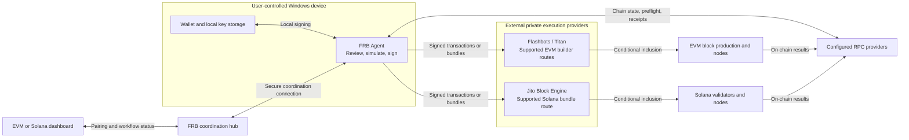

<p align="center">
  <a href="https://ai-frb.com/">
    
  </a>
</p>

<h1 align="center">FRB Agent</h1>
<p align="center"><strong>Local signing. Private execution paths. Control over your capital.</strong></p>

<p align="center">
  <a href="https://ai-frb.com/releases"></a>
  <a href="https://ai-frb.com/install"></a>
  <a href="https://ai-frb.com/terms#license"></a>
  <a href="https://ai-frb.com/security"></a>
  <a href="https://ai-frb.com/"></a>
  <a href="https://www.producthunt.com/products/frb-agent"></a>
</p>

<p align="center">
  <a href="https://ai-frb.com/download"><strong>Download for Windows</strong></a> ·
  <a href="https://ai-frb.com/docs/quickstart">Quick Start</a> ·
  <a href="https://ai-frb.com/docs">Documentation</a> ·
  <a href="https://github.com/FRBLabs">FRB Labs on GitHub</a>
</p>

**Your trading strategy should not require handing a server the keys to your capital.** FRB Agent brings non-custodial EVM and Solana execution to Windows, combining local signing, simulation-first review, and private bundle workflows for traders and MEV searchers who want control over each operation.

**Start with a verified download and a simulation.** Software access has no required subscription; a **20% performance fee** applies to qualifying net profitable executions where the fee logic applies. Network fees, validator tips, slippage, and trading losses remain separate considerations. [Review pricing](https://ai-frb.com/pricing).

[Why local custody](#why-local-custody-matters) · [Execution engines](#execution-engines) · [Architecture](#execution-architecture) · [Install and verify](#quick-start-and-verification) · [Research](#security-research-and-technical-papers) · [Official links](#official-links)

## Why local custody matters

When a hosted trading service stores a usable private key, its infrastructure becomes part of your wallet's security boundary. A server compromise, malicious insider, or privileged database administrator with access to both encrypted keys and decryption material can turn an application incident into a signing incident. Encrypting keys on the same service that can decrypt and use them does not remove that dependency.

FRB's published model keeps signing on your Windows device. The operator selects the wallet, transaction permissions, provider, and execution limits; the local agent prepares and signs the operation. Signed transaction data can leave the device for submission, while private signing keys remain local. [Local execution architecture](https://ai-frb.com/articles/local-mev-execution).

### FRB Agent vs. hosted bots vs. public-RPC wallets

| Dimension | FRB Agent | Telegram trading bots using hosted keys | Wallets submitting through public RPC |
| :--- | :--- | :--- | :--- |
| **Key custody** | Local signing; Windows DPAPI storage is described in FRB's security documentation. | Provider infrastructure holds or can use signing authority. | Usually local or hardware-wallet signing; check the wallet. |
| **MEV protection** | Supported Flashbots, Titan, and Jito paths reduce public pre-inclusion exposure. | Depends on the bot's provider, route, and fallback policy. | Ordinary public broadcast can expose transaction intent; private endpoints change that model. |
| **Execution latency** | Device-to-provider path; affected by connection quality, region, provider, and chain conditions. | Hosted infrastructure may be well located; interface and service hops also matter. | Depends on endpoint, connection, wallet behavior, and network load. |
| **Simulation** | Supported preflight and simulation before approving execution. | Product-specific; inspect what is simulated and against which state. | Often transaction-level checks; bundle support varies. |
| **Multi-chain** | EVM and Solana workflows; available operations and routes vary by release and provider. | Product-specific network and strategy coverage. | Depends on the wallet and configured networks. |
| **Local control** | Local execution environment, wallet configuration, permissions, and route review. | Signing service, updates, and availability are controlled by its operator. | Local approval, with submission delegated to the selected RPC. |

> [!NOTE]
> These columns compare custody and execution models, not every product using a Telegram or browser interface. A web app can use local signing, and a hosted service can use restricted delegated permissions. Evaluate the actual signing authority, permissions, and network path. The table is not a latency benchmark. [Comparison methodology](https://ai-frb.com/research/provider-comparison-methodology.md).

## Execution engines

### Solana: Jito bundles and controlled submission

Use FRB's Solana workflow to prepare operations for the configured Solana RPC or supported Jito Block Engine route. Review the ordered transactions, account requirements, blockhash validity, and expiry before submission.

- **Jito bundle tipping:** set a tip policy and total fee budget using current route requirements; a tip is a competitive bid, not a guarantee of inclusion.
- **Private block-engine routing:** use the supported Jito path to reach its validator execution pipeline without assuming an ordinary RPC submission has the same privacy properties.
- **Anti-sandwich controls:** combine private routing with explicit slippage, size, and expiry limits. Inspect fallback behavior before enabling a live route.
- **Outcome tracking:** distinguish a returned bundle identifier from inclusion and confirmation; check the resulting transactions on-chain.

[Solana setup guide](https://ai-frb.com/docs/solana-setup) · [Open the Solana dashboard](https://sol.ai-frb.com/).

### EVM: Flashbots, Titan, and private bundle workflows

FRB documents private submission through Flashbots and builder routes including Titan. Select a route supported by the installed release and target chain; Ethereum builder support does not imply equivalent support across every EVM network. [Private bundle workflows](https://ai-frb.com/features/private-bundles).

- **Ordered bundles:** prepare related transactions and review target-block, nonce, expiry, and allowed-revert conditions.
- **Gas and priority controls:** review base-fee assumptions, priority bids, builder payments, and spending caps as network conditions change.
- **Preflight review:** inspect the exact transaction sequence against the selected state before approving local signing.
- **Submission reconciliation:** retain the provider result and verify the final receipt before retrying an unresolved operation.

> [!IMPORTANT]
> Private routing reduces public-mempool exposure; it does not make a transaction invisible to its relay or builder, or provide complete immunity to sandwich attacks and other MEV. Privacy, ordering, atomicity, fallback, and inclusion depend on the route. Jito's documented rebroadcast cases also limit bundle atomicity. [Transaction ordering and execution limits](https://ai-frb.com/articles/transaction-ordering).

### Security and local cryptography

FRB's published security model describes **Windows DPAPI encryption at rest**, key loading into the local process for signing, and submission of signed transaction bytes without transferring private keys to FRB's backend. The release notes separately document DPAPI protection for pairing credentials. [Security model](https://ai-frb.com/blog/safety-and-trust-report-2026) · [Release metadata](https://ai-frb.com/api/version).

This separates local key custody from the hosted coordination service. It does not turn Windows into a hardware wallet: malware running with sufficient local privileges, unsafe approvals, and malicious updates remain relevant threats. The public documentation does not establish a per-signature key-erasure guarantee.
This separates local key custody from the hosted coordination service. Windows DPAPI protects stored secrets; device security and transaction permissions remain essential to protecting the signing process.

Use a dedicated execution wallet, protect the Windows account, and review destinations and spending permissions. Keep seed phrases, private keys, and provider secrets out of dashboards, AI prompts, logs, and support messages. Consult the [telemetry policy](https://ai-frb.com/telemetry) for diagnostics and controls.

### Simulation mode: review before committing capital

Start with supported simulation and preflight workflows to inspect an operation without sending a live trade. Record the chain state, transaction inputs, fee assumptions, and provider so the result can be reviewed and reproduced. [Simulation mode](https://ai-frb.com/features/simulation-mode).

Review expected asset changes, gas impact, slippage limits, reverts, and any available profit estimates. A useful review model is:

```text
Estimated net PnL = estimated proceeds after price impact and slippage
                  - input asset cost
                  - network fees
                  - validator tips or builder payments
                  - applicable FRB performance fee
```

Use one valuation currency and avoid counting costs twice. This is an evaluation framework, not a claim that every workflow exposes a complete PnL calculator. A successful simulation cannot predict subsequent liquidity, ordering, or market changes. [Reproducible simulation template](https://ai-frb.com/research/simulation-test-template.json).

## Execution architecture

The diagram summarizes the published local-signing model and separates coordination from transaction submission. It is a conceptual trust-boundary map, not an audited description of every request.



Local execution still depends on network services. The dashboard pairs with the agent; the selected provider receives submission data; blockchain results establish whether execution occurred. The diagram shows private submission paths; ordinary RPC submission has different visibility properties. [Architecture guide](https://ai-frb.com/articles/local-mev-execution) · [Pairing instructions](https://ai-frb.com/docs/quickstart).

## Quick start and verification

**Requirements:** Windows 10 or 11, 64-bit; .NET Framework 4.8; and network access to the selected dashboard, RPC, and relay services. [Installation guide](https://ai-frb.com/install).

1. **Download from the official site.** Open [FRB downloads](https://ai-frb.com/download), choose the appropriate network workflow, and save the Windows installer.
2. **Verify the file before opening it.** Compare its filename and SHA-256 with the official release metadata using the command below. Stop if verification fails.
3. **Install and open FRB Agent.** Follow the setup wizard, review the license, and keep Windows endpoint protection enabled.
4. **Pair the matching dashboard.** Open [EVM](https://evm.ai-frb.com/) or [Solana](https://sol.ai-frb.com/) and enter the six-character pairing code displayed by the agent. Confirm its actual connection status.
5. **Configure and simulate.** Review the wallet, network, provider, destinations, permissions, fee budget, and slippage limits. Resolve preflight failures before approving live execution.
6. **Verify the outcome.** Check provider acceptance, inclusion, and confirmation separately. Inspect unresolved submissions before retrying.

### SHA-256 release fingerprint

The following fingerprint was checked against the official release metadata and the downloaded installer on **28 October 2026**. The installer was downloaded for integrity verification and was not executed.

| Release | Published date | Windows installer | Exact size |
| :--- | :--- | :--- | ---: |
| v8.6 | 15 August 2026 | `FrbAgent_install_vr_8.6.exe` | 14,536,045 bytes |

| Algorithm | Expected digest |
| :--- | :--- |
| SHA-256 | `3fcec860272e137df8237c7af3b07d78ba66a5d1a5589d03b844cac00946956c` |

Sources: [Release history](https://ai-frb.com/releases) · [Current release API](https://ai-frb.com/api/version) · [Release manifest](https://ai-frb.com/releases.json).

**PowerShell one-liner** — checks this exact release in your Downloads location and stops on a mismatch:

```powershell
$expected = '3fcec860272e137df8237c7af3b07d78ba66a5d1a5589d03b844cac00946956c'; $file = Join-Path $env:USERPROFILE 'Downloads\FrbAgent_install_vr_8.6.exe'; if ((Get-FileHash -LiteralPath $file -Algorithm SHA256 -ErrorAction Stop).Hash -ne $expected) { throw 'SHA-256 mismatch. Do not run this file.' }; 'SHA-256 matches the documented v8.6 release.'
```

> [!TIP]
> The version badge follows the current release API; the table records the specific artifact checked above. If the published file changes, obtain its matching checksum from the official release page. A matching hash confirms agreement with published bytes, not an independent security audit.

### Machine-readable release information

| Endpoint | Useful fields |
| :--- | :--- |
| [`/api/version`](https://ai-frb.com/api/version) | `version`, `date`, `file.name`, `file.sha256`, `file.bytes`, `file.downloadUrl` |
| [`/releases.json`](https://ai-frb.com/releases.json) | `latest`, `releases[]`, release notes, and per-file metadata |

These public endpoints support release tracking and integrity checks. Neither an update response nor a download should automatically authorize execution.

## Security research and technical papers

FRB publishes incident analysis, architecture guidance, and reproducible evaluation materials. Use their evidence and limitations when assessing key custody, MEV protection, or provider performance.

| Publication | What it helps you evaluate |
| :--- | :--- |
| [COLDCARD RNG incident: technical root cause and on-chain observations](https://ai-frb.com/research/coldcard-rng-incident-2026) | Entropy failures, firmware control flow, and bounded blockchain evidence. Includes primary-source references and separates observed fund flows from attribution. |
| [WSS/RPC measurement methodology](https://ai-frb.com/research/wss-rpc-measurement-methodology.md) | Repeatable endpoint measurements with environment, sample size, failures, percentiles, and inclusion kept separate. |
| [Dated RPC/WSS observations — 29 August 2026](https://ai-frb.com/research/rpc-wss-observation-2026-08-29.md) | A small public-endpoint dataset with reproducibility limits; it is not a private-RPC ranking or an FRB trading-performance benchmark. |
| [Execution provider comparison methodology](https://ai-frb.com/research/provider-comparison-methodology.md) | How to compare local clients, hosted services, private RPCs, and block engines using consistent evidence. |
| [Non-custodial vs. hosted-key trading models](https://ai-frb.com/blog/truly-non-custodial-vs-telegram-bot-2026) | FRB's analysis of key custody, local signing, and delegated trading authority. Assess each provider's current implementation separately. |
| [Execution security and permissions checklist](https://ai-frb.com/research/security-permissions-checklist.md) | Release review, key lifecycle, spending permissions, network dependencies, and incident readiness. |
| [Simulation test template](https://ai-frb.com/research/simulation-test-template.json) | A structured record of inputs, assumptions, failure cases, and the decision to approve live execution. |

These are published technical resources, not evidence of an independent audit of FRB. The COLDCARD research does not establish that FRB prevents hardware-wallet entropy failures.

## Official links

| Destination | Official link |
| :--- | :--- |
| Website | [ai-frb.com](https://ai-frb.com/) |
| Windows download | [Download FRB Agent](https://ai-frb.com/download) |
| Release history and checksums | [Releases](https://ai-frb.com/releases) |
| Documentation and onboarding | [Documentation](https://ai-frb.com/docs) · [Quick Start](https://ai-frb.com/docs/quickstart) |
| Trading workspaces | [EVM dashboard](https://evm.ai-frb.com/) · [Solana dashboard](https://sol.ai-frb.com/) |
| Security and disclosure | [Security policy](https://ai-frb.com/security) · [Report a vulnerability](https://ai-frb.com/vulnerability) |
| Costs and policies | [Pricing](https://ai-frb.com/pricing) · [Terms](https://ai-frb.com/terms) · [Risk disclosure](https://ai-frb.com/risk) |
| Privacy and diagnostics | [Privacy](https://ai-frb.com/privacy) · [Telemetry](https://ai-frb.com/telemetry) |
| Developer presence | [GitHub @FRBLabs](https://github.com/FRBLabs) |
| Community and launch | [X @FRBLabs](https://x.com/FRBLabs) · [Product Hunt](https://www.producthunt.com/products/frb-agent) |
| Help | [Support](https://ai-frb.com/support) |

For sensitive security findings, use the official disclosure channel; never attach signing keys or seed phrases to a public issue.

## License and non-financial disclaimer

FRB software is supplied under the [published license terms](https://ai-frb.com/terms#license), which describe a limited, revocable, non-transferable license and an as-is basis. Free download access does not grant an open-source license to the application.

FRB provides execution software, not investment advice, asset management, or guaranteed returns. Non-custodial architecture describes where signing authority resides; it does not remove transaction risk or establish regulatory approval. Users remain responsible for authorized use, wallet permissions, configuration, and applicable laws.

MEV strategies and digital-asset trading can result in loss of capital. Simulation, private routing, and positive estimates do not guarantee profitability, inclusion, ordering, or execution success. Review the [risk disclosure](https://ai-frb.com/risk), [pricing](https://ai-frb.com/pricing), and [terms](https://ai-frb.com/terms) before live use.

---

<p align="center">
  <strong>Build your execution workflow around keys you control.</strong><br>
  <a href="https://ai-frb.com/download">Download FRB Agent</a> ·
  <a href="https://ai-frb.com/docs/quickstart">Verify, pair, and simulate</a> ·
  <a href="https://www.producthunt.com/products/frb-agent">Explore FRB on Product Hunt</a>
</p>

<sub>Documentation and release information reviewed on 28 October 2026. Product capabilities are described from official public materials; this README does not constitute a source-code audit.</sub>
